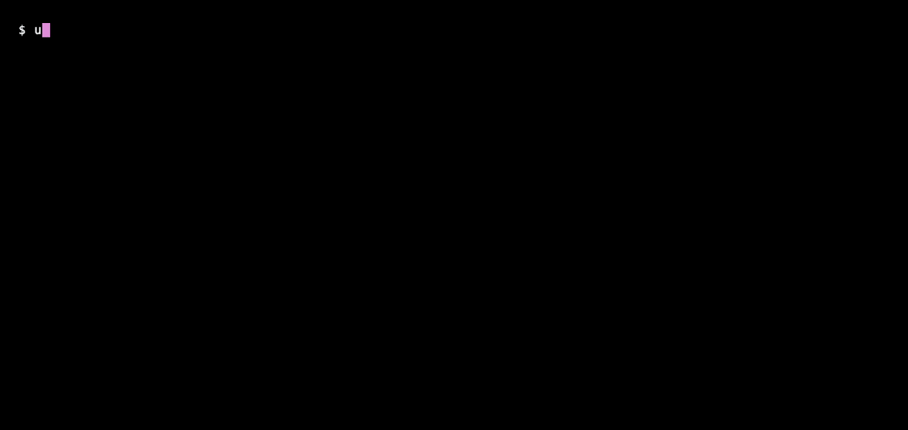
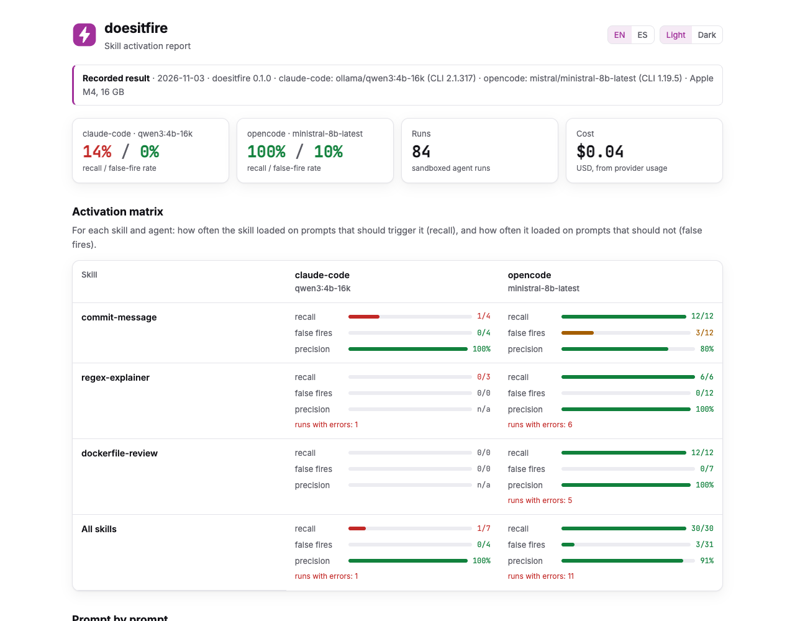
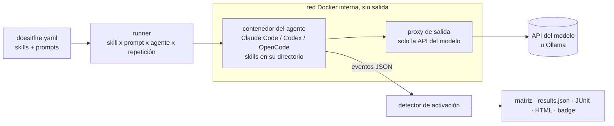

<p align="center">
  
</p>

<p align="center">
  <a href="https://github.com/diegoperezg7/doesitfire/actions/workflows/ci.yml"></a>
  <a href="LICENSE"></a>
  <a href="https://github.com/diegoperezg7/doesitfire/releases"></a>
  <a href="https://github.com/diegoperezg7/doesitfire/stargazers"></a>
</p>

<p align="center"><b>¿Tu SKILL.md se activa de verdad? Prueba la activación de skills en Claude Code, Codex y OpenCode con un solo comando.</b></p>

<p align="center"><a href="README.md">Read in English</a> · <a href="https://diegoperezg7.github.io/doesitfire/">Informe de ejemplo</a></p>

<p align="center"></p>

Has escrito una skill. Su `description` es lo único que ve el agente cuando decide si cargarla.
¿La carga Claude Code cuando un usuario la pide? ¿Y Codex? ¿Y OpenCode? ¿La carga también cuando nadie la pidió?
doesitfire lanza los CLIs reales de los agentes con prompts que deberían activar cada skill y con prompts que no,
varias veces cada uno, y te devuelve una matriz de activación por agente.

## Por qué

Otras herramientas prueban una parte de esto:

| Herramienta | Qué mide | Agentes |
|---|---|---|
| [microsoft/waza](https://github.com/microsoft/waza) (1.499★) | Tiene trigger tests, ejecutados con su ejecutor de GitHub Copilot | GitHub Copilot |
| `claude plugin eval` (incluido en el CLI de Claude Code) | Casos de evaluación con graders contra un plugin o un directorio de skills | Solo Claude Code |
| [darkrishabh/agent-skills-eval](https://github.com/darkrishabh/agent-skills-eval) (809★) | Calidad de la salida con y sin la skill inyectada | No la activación |
| [NVIDIA/SkillEvaluator](https://github.com/NVIDIA/SkillEvaluator) (626★) | Calidad de la salida con y sin la skill inyectada | No la activación |
| **doesitfire** | **Si el agente real carga la skill por sí solo**, y cuántas veces la carga cuando no debería | **Claude Code, Codex, OpenCode** |

Estrellas según la API de GitHub el 3 nov 2026.

## Inicio rápido

La demo no necesita API key, ni Docker, ni modelo. Muestra una ejecución real **grabada** de las tres
skills de ejemplo de [`examples/`](examples):

```bash
uvx --from git+https://github.com/diegoperezg7/doesitfire@v0.1.0 doesitfire demo
```

o desde un clon:

```bash
git clone https://github.com/diegoperezg7/doesitfire && cd doesitfire && uv run doesitfire demo
```

`uvx doesitfire` llegará pronto a PyPI.

## Ejemplo de salida

<!-- results:start -->
Grabado el 2026-11-03 en un Apple M4, 16 GB, con doesitfire 0.1.0. Cada agente usó **su propio CLI** con el modelo indicado; los modelos y repeticiones pueden diferir, así que no compares agentes como si fueran el mismo experimento.

| Agente | CLI | Modelo | Skills | Prompts | Repeticiones | Ejecuciones | Con error (excluidas) |
|---|---|---|---|---|---|---|---|
| claude-code | 2.1.317 | ollama/qwen3:4b-16k | 2 | 12 de 24 | 1 | 12 | 1 |
| opencode | 1.19.5 | mistral/ministral-8b-latest | 3 | 24 | 3 | 72 | 11 |

Errores: claude-code: 1 x `timeout after 900s`; opencode: 11 x `Bad Request`

Activaciones / ejecuciones válidas. *debe* = prompts que deben activar la skill; *no debe* = casi-aciertos que no.

| Skill | claude-code · debe / no debe | opencode · debe / no debe |
|---|---|---|
| `commit-message` | 1/4 / 0/4 | 12/12 / 3/12 |
| `regex-explainer` | 0/3 / 0/0 | 6/6 / 0/12 |
| `dockerfile-review` | 0/0 / 0/0 | 12/12 / 0/7 |
| **todas** | 1/7 / 0/4 | 30/30 / 3/31 |

Recall por agente: claude-code 14%, opencode 100%. Tasa de falsos disparos: claude-code 0%, opencode 10%.

Los eventos JSON en bruto de cada ejecución están en [`examples/recorded/logs/`](examples/recorded/logs).

<p align="center"></p>
<!-- results:end -->

La suite está en [`examples/doesitfire.yaml`](examples/doesitfire.yaml) (todos los agentes con Ollama) y
[`examples/doesitfire.mistral.yaml`](examples/doesitfire.mistral.yaml) (OpenCode con Mistral). Las ejecuciones de OpenCode con
error son respuestas HTTP 400 de Mistral: cuando el modelo llama a una herramienta que doesitfire deniega (por ejemplo
`WebFetch`), la siguiente petición de OpenCode termina con un mensaje de assistant y Mistral la rechaza. Se excluyen de las
tasas; no cuentan como "no se activó".

## Prueba tus propias skills

Necesitas Docker y Ollama (gratis, local) o una API key.

```bash
cd tu-repo                        # con skills en .claude/skills, .agents/skills, skills/, ...
uvx --from git+https://github.com/diegoperezg7/doesitfire@v0.1.0 doesitfire init
# edita doesitfire.yaml: 4 o más prompts que deben cargar cada skill y 4 o más casi-aciertos que no
uvx --from git+https://github.com/diegoperezg7/doesitfire@v0.1.0 doesitfire run
```

`run` construye la imagen de los agentes la primera vez (unos 1,9 GB, unos minutos), imprime la matriz y escribe
`doesitfire-results/` con `results.json`, `report.html`, `junit.xml`, `badge.svg` y `badge.json`.

### Local y gratis con Ollama

Los CLIs de los agentes envían prompts de 6k a 11k tokens y Ollama carga los modelos con 4k de contexto por defecto,
así que crea una vez una variante de 16k (mismos pesos, sin descargar nada más):

```bash
ollama pull qwen3:4b
ollama create qwen3:4b-16k -f ollama/Modelfile   # FROM qwen3:4b + PARAMETER num_ctx 16384
```

En Linux, arranca Ollama con `OLLAMA_HOST=0.0.0.0` para que los contenedores lleguen a él.

### Modelos de pago

Las claves se leen solo de variables de entorno (ver [`.env.example`](.env.example)). Los proveedores de pago
necesitan un precio por millón de tokens para que `--max-cost` (1 USD por defecto) pare antes de pasarse:

```yaml
agents:
  claude-code: {provider: anthropic, model: claude-haiku-5-5, price: {input: 1.0, output: 5.0}}
  codex:       {provider: openai, model: gpt-5.6-luna, price: {input: 0.20, output: 1.20}}
  opencode:    {provider: openrouter, model: deepseek/deepseek-v4.1-flash, price: {input: 0.045, output: 0.50}}
```

| Agente | Proveedores | API que necesita |
|---|---|---|
| Claude Code | `anthropic` (`ANTHROPIC_API_KEY` o `CLAUDE_CODE_OAUTH_TOKEN`), `openrouter`, `ollama` | Anthropic Messages |
| Codex | `openai`, `openrouter`, `ollama` | OpenAI Responses |
| OpenCode | `ollama`, `openrouter`, `openai`, `mistral`, `anthropic` | Chat Completions o Anthropic |

## Cómo funciona



Para cada skill, prompt, agente y repetición, doesitfire arranca un contenedor nuevo, copia las skills en el
directorio que descubre ese agente (`.claude/skills`, `.agents/skills`, `.opencode/skills`) y ejecuta el CLI sin
interfaz. Lee el flujo de eventos JSON del CLI según llega:

| Agente | Comando | Una ejecución cuenta como activación cuando |
|---|---|---|
| Claude Code | `claude -p --output-format stream-json --verbose` | una llamada a la herramienta `Skill` nombra la skill |
| OpenCode | `opencode run --format json` | se llama a su herramienta nativa `skill` con la skill |
| Codex (experimental) | `codex exec --json` | un comando lee `<skill>/SKILL.md`. Codex no documenta un evento de activación, así que se infiere |

Con un modelo local, la ejecución se corta en cuanto se conoce el resultado (se activó una skill probada o se llegó
al tope de turnos). Con un modelo de pago, llega hasta el final para que el CLI informe del uso de tokens.

**Métricas**, por agente y skill: **recall** (ejecuciones que debían cargar la skill y la cargaron),
**tasa de falsos disparos** (ejecuciones que no debían y la cargaron) y **precisión** (cargas que tocaban). Las
ejecuciones que fallan (timeout, error de la API) quedan fuera de todas las tasas y se muestran aparte.

**Aislamiento.** Cada contenedor corre sin root, con el sistema de ficheros raíz en solo lectura, sin capacidades,
con `no-new-privileges` y límites de CPU, memoria, procesos y tiempo. Su único vecino de red es un proxy de salida
que deja pasar el host y puerto de la API del modelo y responde 403 a todo lo demás (los intentos bloqueados salen
en el informe). Bash, Write, Edit y las herramientas web están denegadas en Claude Code; edit, bash y webfetch en
OpenCode; y los turnos se limitan a 2. Codex no tiene una herramienta de lectura sin efectos y su propio sandbox no
arranca dentro de un contenedor sin privilegios, así que su shell corre dentro de los límites del contenedor.
doesitfire se niega a ejecutar sin Docker. Detalles en [SECURITY.md](SECURITY.md).

## Configuración

```yaml
repeats: 3        # ejecuciones por prompt y agente; la activación no es determinista
timeout: 300      # segundos por ejecución
max_turns: 2      # turnos por ejecución; la activación ocurre en el primero
cpus: 1           # por contenedor
memory: 1g        # por contenedor

agents:
  claude-code: {provider: ollama, model: qwen3:4b-16k}
  codex:       {provider: ollama, model: qwen3:4b-16k}
  opencode:    false            # omitir un agente

skills:
  - path: .claude/skills/commit-message     # un directorio con un SKILL.md
    should_fire:
      - "Write a commit message for my change: I added a login form."
    should_not_fire:
      - "How do I undo my last git commit but keep the changes?"
```

| Comando | Qué hace |
|---|---|
| `doesitfire init [DIR]` | Escribe `doesitfire.yaml` con todas las skills que encuentra bajo `DIR` |
| `doesitfire run` | Ejecuta la matriz. `--agents`, `--skills`, `--repeats`, `--max-cost`, `--min-recall`, `--max-false-fire`, `--out` |
| `doesitfire report results.json` | Vuelve a generar la matriz, el HTML, el JUnit y el badge |
| `doesitfire demo` | Muestra la ejecución de ejemplo grabada |

Con `--min-recall 0.75 --max-false-fire 0.25`, `run` sale con código 1 si alguna celda agente x skill no los
cumple; es lo que quieres en CI. Si se alcanza el presupuesto sale con código 3 y conserva los resultados parciales.

## GitHub Action

Solo en runners Linux (los agentes corren en Docker; los runners alojados de macOS no traen Docker):

```yaml
- uses: diegoperezg7/doesitfire@v0.1.0
  with:
    config: doesitfire.yaml
    max-cost: "1.0"
    min-recall: "0.75"
    max-false-fire: "0.25"
  env:
    ANTHROPIC_API_KEY: ${{ secrets.ANTHROPIC_API_KEY }}
```

Un workflow completo que además sube el informe y los resultados JUnit está en
[`examples/workflows/doesitfire.yml`](examples/workflows/doesitfire.yml).

**Badge.** `run` escribe `badge.svg` y `badge.json` (un [endpoint de shields.io](https://shields.io/badges/endpoint-badge)).
Sube `badge.svg` al repo y enlázalo, o publica `badge.json` (por ejemplo en GitHub Pages) y usa
`https://img.shields.io/endpoint?url=<url-de-badge.json>`.

## Qué se ha probado en vivo

| Agente | Probado en vivo con | Notas |
|---|---|---|
| Claude Code 2.1.317 | Ollama `qwen3:4b` (contexto de 16k) a través del endpoint `/v1/messages` compatible con Anthropic de Ollama. La demo grabada tiene 12 de los 24 prompts (1 repetición): a 4-14 minutos por ejecución en este portátil, el resto no terminó a tiempo | Sin modelo Claude: esta versión se construyó sin clave de Anthropic. `provider: anthropic` (API key o `CLAUDE_CODE_OAUTH_TOKEN` de `claude setup-token`) tiene tests unitarios, pero no se ha probado en vivo. |
| Codex 0.166.0 | Soportado; la detección de activación está validada en el test de integración con Docker (el CLI real de Codex contra el modelo simulado), no en la demo grabada | La detección es **experimental** (lecturas de `SKILL.md`). Se lanzó una ejecución en vivo con Ollama que no terminó a tiempo para la v0.1.0. |
| OpenCode 1.19.5 | Mistral `ministral-8b-latest` (de pago, compatible con OpenAI) | Es el que usa la demo grabada. También se comprobó con Ollama durante el desarrollo. |

Mistral es el único proveedor de pago llamado en vivo (OpenCode, 72 ejecuciones, coste medido con el usage). Anthropic,
OpenAI y OpenRouter están conectados y tienen tests unitarios, incluido el límite `--max-cost`, pero no se han llamado. En cada push, la CI ejecuta
los tres CLIs reales en Docker contra un modelo simulado ([`tests/mockmodel.py`](tests/mockmodel.py)), así que si
cambia la salida de un CLI se rompe la build, no tus resultados.

Cada agente corre con la configuración por defecto de su CLI, thinking incluido. Desactivar el thinking de qwen3 en
Ollama parece acelerar, pero el modelo escribe entonces su razonamiento como texto y se para antes de emitir la llamada
a la herramienta, así que parece que las skills nunca se activan. doesitfire no lo hace.

Hay una rareza de Ollama que se resuelve sola: la Responses API de Ollama descarta los mensajes con rol `developer`, que
es donde Codex lista las skills disponibles. Solo para Codex con Ollama, el proxy de salida los reescribe a `system`
(HTTP plano hacia tu Ollama local; el tráfico HTTPS hacia APIs de pago pasa por el túnel sin tocarse).

## Hoja de ruta

- Cursor, Gemini CLI y GitHub Copilot CLI.
- Sugerir prompts y mejores descripciones con un LLM.
- Conversaciones de varios turnos.
- Conflictos entre skills (dos skills que compiten por el mismo prompt).
- Publicación en GitHub Marketplace.

## Licencia

[MIT](LICENSE). Las tres skills de ejemplo de `examples/skills` también son MIT y se escribieron para este proyecto.
