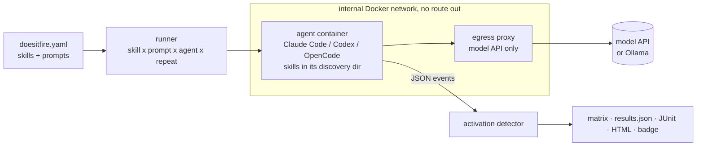

<p align="center">
  
</p>

<p align="center">
  <a href="https://github.com/diegoperezg7/doesitfire/actions/workflows/ci.yml"></a>
  <a href="LICENSE"></a>
  <a href="https://github.com/diegoperezg7/doesitfire/releases"></a>
  <a href="https://github.com/diegoperezg7/doesitfire/stargazers"></a>
</p>

<p align="center"><b>Does your SKILL.md actually fire? Test skill activation in Claude Code, Codex and OpenCode with one command.</b></p>

<p align="center"><a href="README.es.md">Leer en español</a> · <a href="https://diegoperezg7.github.io/doesitfire/">Example report</a></p>

<p align="center"></p>

You wrote a skill. Its `description` is the only thing the agent sees when it decides whether to load it.
Does Claude Code load it when a user asks for it? Does Codex? Does OpenCode? Does it also load when nobody asked?
doesitfire runs the real agent CLIs on prompts that should and should not trigger each skill, a few times each,
and gives you one activation matrix per agent.

## Why

Other tools test part of this:

| Tool | What it measures | Agents |
|---|---|---|
| [microsoft/waza](https://github.com/microsoft/waza) (1,499★) | Has trigger tests, run through its GitHub Copilot executor | GitHub Copilot |
| `claude plugin eval` (built into the Claude Code CLI) | Eval cases with graders against a plugin or skills dir | Claude Code only |
| [darkrishabh/agent-skills-eval](https://github.com/darkrishabh/agent-skills-eval) (809★) | Output quality with vs without the skill injected | Not activation |
| [NVIDIA/SkillEvaluator](https://github.com/NVIDIA/SkillEvaluator) (626★) | Output quality with vs without the skill injected | Not activation |
| **doesitfire** | **Whether the real agent loads the skill on its own**, and how often it loads it when it should not | **Claude Code, Codex, OpenCode** |

Star counts from the GitHub API on 3 Nov 2026.

## Quickstart

The demo needs no API key, no Docker and no model. It shows a **recorded** real run of the three
example skills in [`examples/`](examples):

```bash
uvx --from git+https://github.com/diegoperezg7/doesitfire@v0.1.0 doesitfire demo
```

or from a clone:

```bash
git clone https://github.com/diegoperezg7/doesitfire && cd doesitfire && uv run doesitfire demo
```

`uvx doesitfire` is coming to PyPI.

## Example output

{{RESULTS}}

## Test your own skills

You need Docker and either Ollama (free, local) or an API key.

```bash
cd your-repo                      # with skills in .claude/skills, .agents/skills, skills/, ...
uvx --from git+https://github.com/diegoperezg7/doesitfire@v0.1.0 doesitfire init
# edit doesitfire.yaml: 4+ prompts that should load each skill, 4+ near misses that should not
uvx --from git+https://github.com/diegoperezg7/doesitfire@v0.1.0 doesitfire run
```

`run` builds the agent image on first use (about 1.9 GB, a few minutes), then prints the matrix and writes
`doesitfire-results/` with `results.json`, `report.html`, `junit.xml`, `badge.svg` and `badge.json`.

### Local and free with Ollama

The agent CLIs send 6k to 11k token prompts, and Ollama loads models with a 4k context by default, so create a
16k variant once (same weights, no extra download):

```bash
ollama pull qwen3:4b
ollama create doesitfire-qwen3:4b-16k -f ollama/Modelfile   # FROM qwen3:4b + PARAMETER num_ctx 16384
```

On Linux, start Ollama with `OLLAMA_HOST=0.0.0.0` so containers can reach it.

### Paid models

Keys are read from environment variables only (see [`.env.example`](.env.example)). Paid providers need a
price per million tokens so `--max-cost` (default 1 USD) can stop the run before it overspends:

```yaml
agents:
  claude-code: {provider: anthropic, model: claude-haiku-5-5, price: {input: 1.0, output: 5.0}}
  codex:       {provider: openai, model: gpt-5.6-luna, price: {input: 0.20, output: 1.20}}
  opencode:    {provider: openrouter, model: deepseek/deepseek-v4.1-flash, price: {input: 0.045, output: 0.50}}
```

| Agent | Providers | API it needs |
|---|---|---|
| Claude Code | `anthropic` (`ANTHROPIC_API_KEY` or `CLAUDE_CODE_OAUTH_TOKEN`), `openrouter`, `ollama` | Anthropic Messages |
| Codex | `openai`, `openrouter`, `ollama` | OpenAI Responses |
| OpenCode | `ollama`, `openrouter`, `openai`, `mistral`, `anthropic` | Chat Completions or Anthropic |

## How it works



For every skill, prompt, agent and repeat, doesitfire starts a fresh container, copies the skills into that
agent's discovery directory (`.claude/skills`, `.agents/skills`, `.opencode/skills`) and runs the CLI headless.
It reads the CLI's JSON event stream as it arrives:

| Agent | Command | A run counts as fired when |
|---|---|---|
| Claude Code | `claude -p --output-format stream-json --verbose` | a `Skill` tool call names the skill |
| OpenCode | `opencode run --format json` | its native `skill` tool is called with the skill |
| Codex (experimental) | `codex exec --json` | a command reads `<skill>/SKILL.md`. Codex documents no activation event, so this is inferred |

With a local model, a run stops as soon as the outcome is known (a tested skill fired, or the turn cap was hit).
With a paid model, it runs to the end so the CLI reports token usage for the budget.

**Metrics**, per agent and skill: **recall** (should-fire runs that loaded the skill), **false-fire rate**
(should-not runs that loaded it) and **precision** (loads that were wanted). Runs that error out (timeout,
API error) are left out of every rate and shown apart.

**Isolation.** Each container is non-root, with a read-only root filesystem, all capabilities dropped,
`no-new-privileges`, CPU, memory, pids and time limits. Its only network peer is an egress proxy that allows the
model API host and port and returns 403 for everything else (blocked attempts are listed in the report).
Bash, Write, Edit and web tools are denied in Claude Code, edit, bash and webfetch in OpenCode, and turns are
capped at 2. Codex has no read-only file tool and its own sandbox cannot start inside an unprivileged container,
so its shell runs inside the container limits. doesitfire refuses to run without Docker. Details in
[SECURITY.md](SECURITY.md).

## Configuration

```yaml
repeats: 3        # runs per prompt and agent; activation is not deterministic
timeout: 300      # seconds per agent run
max_turns: 2      # agent turns per run; activation happens in the first one
cpus: 1           # per container
memory: 1g        # per container

agents:
  claude-code: {provider: ollama, model: doesitfire-qwen3:4b-16k}
  codex:       {provider: ollama, model: doesitfire-qwen3:4b-16k}
  opencode:    false            # skip an agent

skills:
  - path: .claude/skills/commit-message     # a directory with a SKILL.md
    should_fire:
      - "Write a commit message for my change: I added a login form."
    should_not_fire:
      - "How do I undo my last git commit but keep the changes?"
```

| Command | What it does |
|---|---|
| `doesitfire init [DIR]` | Writes `doesitfire.yaml` with every skill found under `DIR` |
| `doesitfire run` | Runs the matrix. `--agents`, `--skills`, `--repeats`, `--max-cost`, `--min-recall`, `--max-false-fire`, `--out` |
| `doesitfire report results.json` | Re-renders the matrix, HTML, JUnit and badge |
| `doesitfire demo` | Shows the recorded example run |

`--min-recall 0.75 --max-false-fire 0.25` makes `run` exit 1 when any agent x skill cell misses them; that is
what you want in CI. Budget stops exit 3 and keep the partial results.

## GitHub Action

Linux runners only (the agents run in Docker; hosted macOS runners have no Docker):

```yaml
- uses: diegoperezg7/doesitfire@v0.1.0
  with:
    config: doesitfire.yaml
    max-cost: "1.0"
    min-recall: "0.75"
    max-false-fire: "0.25"
  env:
    ANTHROPIC_API_KEY: ${{ secrets.ANTHROPIC_API_KEY }}
```

A complete workflow that also uploads the report and the JUnit results is in
[`examples/workflows/doesitfire.yml`](examples/workflows/doesitfire.yml).

**Badge.** `run` writes `badge.svg` and `badge.json` (a [shields.io endpoint](https://shields.io/badges/endpoint-badge)).
Commit `badge.svg` and link it, or publish `badge.json` (for example to GitHub Pages) and use
`https://img.shields.io/endpoint?url=<url-of-badge.json>`.

## What was live-tested

| Agent | Live-tested with | Notes |
|---|---|---|
| Claude Code 2.1.317 | Ollama `qwen3:4b` (16k context) through Ollama's Anthropic-compatible `/v1/messages` | No Claude model: this release was built without an Anthropic key. `provider: anthropic` (API key or `CLAUDE_CODE_OAUTH_TOKEN` from `claude setup-token`) is unit-tested, not live-tested. |
| Codex 0.166.0 | Ollama `qwen3:4b` through the Responses API | Detection is **experimental** (reads of `SKILL.md`). |
| OpenCode 1.19.5 | Ollama `qwen3:4b` through Chat Completions | |

Paid providers (Anthropic, OpenAI, OpenRouter, Mistral) are wired and unit-tested, including the `--max-cost` guard,
but no paid model was called to build this release. CI runs the three real CLIs in Docker against a scripted mock
model ([`tests/mockmodel.py`](tests/mockmodel.py)) on every push, so a CLI output change breaks the build, not your results.

With a local model, doesitfire turns thinking off and caps output at 4,096 tokens for all three agents; a 4B model
that thinks for thousands of tokens per call makes a 216-run matrix take a day. Paid models run with the CLI defaults.

## Roadmap

- Cursor, Gemini CLI and GitHub Copilot CLI.
- Suggesting prompts and better descriptions with an LLM.
- Multi-turn conversations.
- Conflicts between skills (two skills competing for the same prompt).
- GitHub Marketplace listing.

## License

[MIT](LICENSE). The three example skills in `examples/skills` are MIT too and were written for this project.
